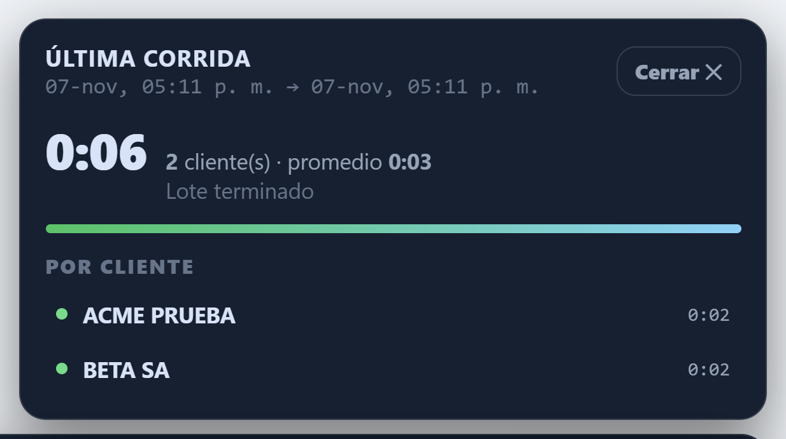
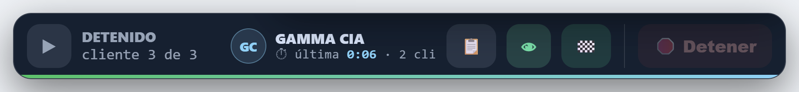

# Capa de experiencia — modo de vista, cronómetro y resumen

**Archivo:** `src/08_experiencia.js` · **Build:** `3.2.0+20261107.1711` · **Suite:** 909 verdes

Qué se agregó, por qué está afuera de los otros módulos y cómo probarlo.
Nace de una sesión de uso real: *«quiero coherencia, que no sature, dos modos,
y saber cuánto tarda el bucle»*.

---

## 1 · Los dos modos

| | **Cockpit** (por defecto) | **Limpio** |
| :--- | :--- | :--- |
| HUD | Todos los controles | ▶ · estado · cliente · cronómetro · 📋 · 👁 · 🏁 · 🛑 |
| Panel lateral | Visible si estaba abierto | Oculto |
| Isla del login / minibar | Visible | Oculto |
| Saludo y tarjeta contextual | Visibles | Ocultos |
| Cajón 🧰 | Disponible | Oculto (el resto de botones también) |

Se cambia con el **ojo 👁 del HUD** o con **`Alt+Shift+M`**, y se recuerda en
`chrome.storage.local` (`sc_modo_vista`). El atajo `Alt+Shift+T` abre el
resumen.

Regla que se aplicó: en limpio **no se esconde la extensión, se esconde lo que
no se toca mientras se declara**. Las tres acciones que pueden hacer falta en
medio de un cliente (▶, 🏁, 🛑) siguen ahí, y el ojo devuelve todo.

## 2 · Cronómetro del lote

Vive del semáforo que ya existía (`sc_loop`), sin tocar el motor del bucle:

- **Arranca** cuando `estado` pasa a `CORRIENDO` (usa el `latido` que escribe
  `SriLoop.iniciar`, o sea la hora real de arranque).
- **Pausa** descuenta el tiempo en `PAUSADO`/`PAUSANDO`.
- **Por cliente**: reloj de pared entre avances, no `latido` — dos relojes
  distintos en la misma tarjeta dan una cuenta que no cierra.
- **Sobrevive a la recarga**: se guarda en `sc_corrida` y, si la página se
  recarga en medio del lote, se retoma con el tiempo ya transcurrido.

En el HUD se ve así:

```
⏱ 4:12 · ≈11:30        ← en curso (total y estimación de lo que falta)
⏸ 4:12 en pausa        ← pausado
⏱ última 12:40 · 6 cli ← terminado
⏱ sin datos            ← nunca corrió en este navegador
```

La estimación (`≈`) es promedio real × clientes restantes; si no hay ningún
cliente terminado todavía, no se muestra (no se inventa un ETA).

## 3 · Resumen de la corrida

Al pasar a `DETENIDO` con clientes terminados se abre solo un panel (no es un
modal, no bloquea el portal) con: tiempo total, cantidad de clientes,
promedio, motivo de la detención y el tiempo de cada cliente. Se cierra con ✕
o con clic afuera, y se puede volver a abrir desde 📋.

Se guardan las últimas 10 corridas en `sc_corridas`. Dos pestañas del SRI
mirando el mismo lote cierran a la vez: se guarda una sola.



## 4 · Cliente en curso, a la vista

Nombre (con iniciales), y al lado el tiempo. Antes, para saber por quién iba
el bot había que abrir el panel de clientes. Si no hay cliente, dice
`Sin cliente` en vez de dejar el bloque vacío.

## 5 · Dormido cuando no hay nada que declarar

En el perfil del contribuyente se pregunta a `SriLoopHUD.veredictoDelPerfil()`
(que ya sabe leer las obligaciones del portal):

- `no_declara_iva` → chip **💤 SIN IVA** y el HUD baja a 72 % de opacidad.
- `ya_declarada` → chip **💤 YA DECLARADA**.

No se esconden controles: un veredicto equivocado no puede dejar a nadie sin
su botón de parada. El motivo completo queda en el `title` del chip y en la
consola (`💤 [EXPERIENCIA] Perfil dormido: …`).

## 6 · Lanzador de clientes (🧑)

Sólo con el lote detenido. Busca por nombre o RUC sobre `sc_clients_cache` y,
al elegir un cliente, arranca **una corrida de uno solo** con el mismo
contrato que usa el popup (`pending_sri_autofill` + `pendingAction` +
semáforo en `DETENIDO`) y abre el login del SRI.

Si el cliente no tiene clave, avisa y no hace nada. Si el lote está corriendo,
avisa y no interrumpe.



## 7 · Por qué es un archivo aparte

No modifica ni el motor del bucle (02), ni los paneles (06, 07), ni el login
(03). Se engancha desde afuera: escucha `chrome.storage.onChanged`, espera el
HUD con un `MutationObserver` y agrega su bloque. Si esta capa falla, se cae
solo el cronómetro; el resto sigue declarando.

Tampoco agrega servicios: **todo es local** (`chrome.storage.local`). No usa
R2, ni Supabase, ni ninguna API paga.

## 8 · Qué falta (siguiente tanda)

1. **Visual de las fases de recolección y llenado.** Hoy la capa ordena el
   ruido; el siguiente paso es que la extracción de comprobantes y el llenado
   del formulario tengan su propio progreso visible (por casillero y por
   comprobante), no sólo el plan de fases del HUD.
2. **Contexto por sección**: que el lanzador de clientes aparezca también en
   el resumen del formulario, y que el panel lateral no se abra nunca solo
   (hoy ya arranca plegado).
3. **Historial visible**: `sc_corridas` guarda 10 corridas; falta la pantalla
   para compararlas (hoy sólo se ve la última).

## 9 · Cómo probarlo

Automático (sin tocar tu Chrome, perfil temporal, host del SRI mapeado a
127.0.0.1):

```powershell
cd "C:\Programacion\Paginas Web\SantiagoCordova.com\extenciones web"

# montaje del HUD, modos, cronómetro y resumen
powershell -ExecutionPolicy Bypass -File tools\prueba_experiencia.ps1 -Python "C:\ruta\python.exe"

# popup + riel de la suite
powershell -ExecutionPolicy Bypass -File tools\prueba_suite.ps1
```

Manual, en el portal:

1. Abrir el SRI con la extensión despierta: el HUD debe mostrar
   `Sin cliente` y `⏱ sin datos`.
2. `Alt+Shift+M`: quedan ▶ · estado · cliente · ⏱ · 📋 · 👁 · 🏁 · 🛑 y
   desaparecen panel, isla y saludo. Repetir para volver.
3. Correr un cliente: el nombre aparece y el cronómetro avanza; al pasar al
   siguiente cambia el nombre.
4. Terminar el lote: se abre el resumen con el tiempo de cada cliente.
5. Entrar al perfil de un contribuyente sin obligación de IVA: chip 💤.

La prueba automática de esta capa vive en `tools/prueba_experiencia.ps1`
(montaje, modos, cronómetro y resumen) y en el banco de 909 comprobaciones de
`tests/run.mjs`, que sigue verde con el módulo nuevo adentro.
