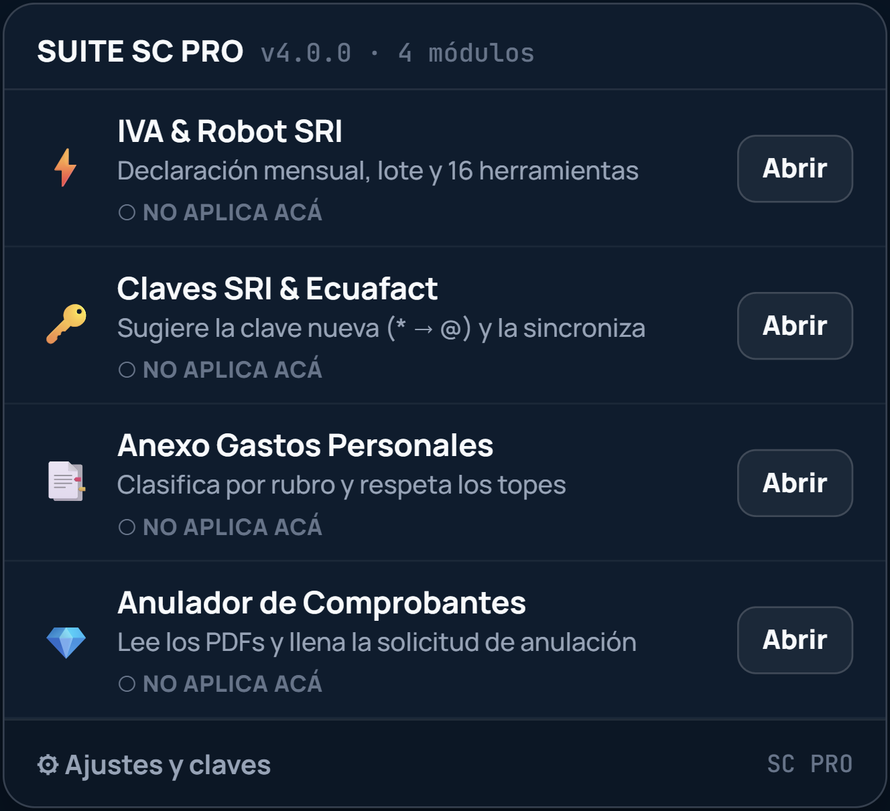

# Extensiones Web — SC PRO

Automatización del portal del SRI para el estudio contable. Cuatro módulos que
cubren el ciclo tributario, empaquetados de dos maneras: **una suite única**
(`suite/`) y **las cuatro extensiones individuales**.

> **Estado (nov-2026):** la suite se genera desde las carpetas individuales y
> está probada en lo que se puede probar sin el portal: **carga** (manifiesto +
> service worker), **popup con el riel de los cuatro módulos** e **inyección de
> un módulo empaquetado** (el 02, sobre una página local). **No se probó todavía
> contra el portal real del SRI**: antes de usarla para declarar en serio, hacé
> la lista de `suite/README.md` § *Primera prueba*. Lo que está abierto y en qué
> orden atacarlo, en `docs/ESTADO_ACTUAL_2026-11.md`.

---

## Mapa de la carpeta

```
extenciones web/
├── suite/                      🧰 Extensión única (GENERADA, no editar)
├── 01_Nueva_Luz_3.0/           ⚡ Declaración de IVA 2011 + robot del SRI
├── 02_Cambio_Claves_SRI/       🔑 Claves SRI & Ecuafact
├── 03_Anexo_Gastos_Personales/ 📑 Anexo de gastos personales
├── 04_Anulador_Comprobantes_SRI/ 💎 Anulación masiva de comprobantes
├── tools/                      Construcción y pruebas de la suite
│   ├── verificar.ps1           Puerta de calidad (todo en un comando)
│   ├── construir_suite.mjs     Genera suite/ desde las cuatro carpetas
│   ├── suite_rail.js           Botón 🧰 del popup de la suite
│   ├── prueba_suite.ps1        Carga la suite y verifica popup + riel
│   ├── prueba_experiencia.ps1  Verifica HUD, modos, cronómetro y resumen
│   └── prueba_inyeccion.ps1    Verifica que un módulo se inyecte y funcione
├── docs/                       Manuales, informes y el PDF de casilleros
├── _archivo/                   Versiones viejas (no se instalan)
│   ├── legacy/                 Extractor V1, automatización previa, cruft
│   └── cruft/                  Restos de Windows que viajaban en la 03
├── _respaldos/                 Copias intactas (no se instalan)
│   ├── extensiones_2026/       Respaldo completo anterior a la reorganización
│   └── 04_anulador_previo/     Anulador previo + facturas de prueba
└── _EVIDENCIA_SRI/             Capturas, XML y PDF de auditoría (SENSIBLE)
```

Las rutas de las cuatro extensiones **no cambiaron**: lo que se movió fueron los
respaldos, el archivo viejo y los documentos. Si Chrome las tiene cargadas,
siguen funcionando.

Además, cada extensión tiene su **`recorridos/`**: la copia de trabajo de la
evidencia de Burp —respuestas y recorridos reales del portal— para pulir ese
módulo sin salir de su carpeta. Está fuera de git; Chrome la carga como parte de la extensión, así que al armar un ZIP hay que excluirla.
Mapa completo y qué falta capturar: [`docs/RECORRIDOS.md`](docs/RECORRIDOS.md).

---

## Las dos formas de usar esto

| | `suite/` | Cada carpeta individual |
| :--- | :--- | :--- |
| Instalación | Una sola | Una por módulo |
| Icono | Uno | Cuatro |
| Popup | El panel de la 01 + botón 🧰 con los otros tres | El popup propio de cada módulo |
| Claves y ajustes | `chrome.storage.local` **de la suite** | `chrome.storage.local` **de cada extensión** |
| Ideal para | El día a día: declarar, cambiar claves, anexos, anular | Trabajar un módulo puntual o volver a la versión sin suite |

**Regla de convivencia:** no tengas instalado a la vez el standalone y la suite
del **mismo** módulo. Se inyectan los dos en la misma página y aparecen dos
paneles, dos burbujas y dos flujos. Elegí uno por módulo.

**Ojo con las claves:** `chrome.storage.local` es por extensión. La suite no ve
las claves SRI, la clave de IA ni los mapeos que ya tenga guardados la 01 o la 03
individual. Si pasás a la suite, hay que volver a cargar en **Ajustes** lo que
haga falta (el botón "Ajustes y claves" del riel 🧰 abre esa página).

Así se ve el riel de la suite (captura real del popup, sin datos de clientes):



La suite —y la 01 individual— traen además una **capa de experiencia** en el
portal: dos modos (limpio y cockpit), cronómetro del lote con estimación,
nombre del cliente en curso, resumen al terminar y lanzador de clientes.
Detalle en [`01_Nueva_Luz_3.0/EXPERIENCIA_2026-11.md`](01_Nueva_Luz_3.0/EXPERIENCIA_2026-11.md).

---

## Instalar

### Suite (recomendado para el día a día)

1. `chrome://extensions/` → activar **Modo de desarrollador**.
2. **Cargar descomprimida** → elegir
   `…\SantiagoCordova.com\extenciones web\suite`.
3. Recargar las pestañas del SRI que ya estuvieran abiertas.

### Individuales

Mismo procedimiento, eligiendo la carpeta del módulo:

| Módulo | Carpeta |
| :--- | :--- |
| ⚡ IVA | `extenciones web\01_Nueva_Luz_3.0` |
| 🔑 Claves | `extenciones web\02_Cambio_Claves_SRI` |
| 📑 Gastos | `extenciones web\03_Anexo_Gastos_Personales` |
| 💎 Anulador | `extenciones web\04_Anulador_Comprobantes_SRI` |

---

## La suite es un artefacto, no un fork

`suite/` se genera copiando y aislando los content scripts de las cuatro
carpetas. Su fuente de verdad son **las carpetas individuales**: se arregla el
módulo, se vuelve a compilar la suite.

```powershell
cd "C:\Programacion\Paginas Web\SantiagoCordova.com\extenciones web"

node tools/construir_suite.mjs           # regenera suite/
node tools/construir_suite.mjs --check   # avisa si suite/ quedó vieja
```

Qué valida el constructor antes de dar la suite por buena:

- que el manifiesto no apunte a ningún archivo inexistente,
- que cada módulo generado compile (`node --check`),
- que `01_Nueva_Luz_3.0/build/content.js` no sea más viejo que su `src/`
  (si lo es, avisa: hay que correr `npm run build` en la 01).

Por qué cada módulo va envuelto en `(function(){ … })()`: los cuatro content
scripts comparten el mismo mundo aislado de la extensión. Dos `const` con el
mismo nombre en archivos distintos serían un error de sintaxis que mata el
módulo entero, sin mensaje visible. La IIFE les devuelve su ámbito.

Después de regenerar: `chrome://extensions/` → ↻ en **SC PRO SUITE**.

### Probarla antes de confiar en ella

```powershell
cd "C:\Programacion\Paginas Web\SantiagoCordova.com\extenciones web"

# Puerta de calidad: sintaxis + build + 909 bancos + suite + manifiestos
powershell -ExecutionPolicy Bypass -File tools\verificar.ps1

# Sumando las pruebas de navegador (Edge + Python)
powershell -ExecutionPolicy Bypass -File tools\verificar.ps1 -ConNavegador -Python "C:\ruta\python.exe"
```

`verificar.ps1` es el comando único antes de entregar: si algo está en rojo,
no se entrega. Después están las pruebas puntuales:

`prueba_suite.ps1` abre la suite en una instancia aparte de Edge (Chrome
estable ya ignora `--load-extension`) y comprueba que el manifiesto cargue, el
service worker arranque y el riel del popup pinte los cuatro módulos.
`prueba_inyeccion.ps1` usa el módulo 02 como canario sobre una página local y
verifica que un módulo empaquetado **se inyecte y complete** `clave123*` →
`clave123@` (necesita Python para servir la página).
`prueba_experiencia.ps1` verifica el HUD: modos, cronómetro y resumen.

Las tres usan perfil temporal y ventana fuera de pantalla: no tocan tu Chrome.
Lo que **no** prueban es el portal real; para eso, `suite/README.md` §
*Primera prueba*.

### Cuándo hay que regenerar

- Cambió cualquier `content.js` de 01/02/03/04 → regenerar.
- Cambió el popup o los ajustes de la 01 → regenerar (la suite los copia).
- Cambió `tools/suite_rail.js` → regenerar.

`--check` sirve para saberlo sin mirar fechas.

---

## Seguridad

- `_EVIDENCIA_SRI/` tiene capturas con RUC, nombres y correos de
  contribuyentes reales, y exports de Burp con cookies de sesión vivas.
  **Está protegida por `.gitignore` y no debe salir de este equipo.** Si se
  mueve o se renombra la carpeta, hay que mover también esas reglas o el
  material queda expuesto a un `git add`.
- La clave de Gemini ya **no está en el código**: se lee de
  `chrome.storage.local` (`sc_ia_credenciales`), la misma entrada que usa la
  01, y se carga desde el popup de la 03 (**IA · Gemini**) o desde Ajustes.
  Sin clave, la clasificación sigue por catastro y mapeos: no se rompe nada.
  **Falta rotarla**: sigue en el historial de git y en `_respaldos/`.
- El remoto de git tenía un token en la URL. Rotarlo y usar credential manager
  o SSH: ver `docs/RUNBOOK.md` §6.
- Credenciales de R2 y de IA de la 01: van en **Ajustes**, no en el código.

---

## Documentación

| Archivo | Para qué |
| :--- | :--- |
| `docs/SELECCION_DE_LOTE.md` | Qué es la «selección» (antes Bendita) y cuándo usarla |
| `docs/PLAN_MAESTRO.md` | Fases 0–6 con criterio de terminado |
| `docs/CAMBIOS_4.2.0.md` | Notas de la versión 4.2.0 |
| `docs/INFORME_FLOTANTES.md` | Diagnóstico de las flotantes y diseño final |
| `docs/ANALISIS_INTERFAZ_Y_ESCALA.md` | Visión de producto contra lo construido |
| `docs/CONTRATO_PURCHASE_SUMMARY.md` | Datos de compras: extensión → web |
| `docs/RUNBOOK.md` | **Cómo operar y entregar**: ciclo de cambio, rollback, incidentes, secretos |
| `docs/RECORRIDOS.md` | Evidencia real del portal por extensión y qué falta capturar |
| `docs/ANULACIONES_COBRO.md` | Cómo se numera y se cobra cada anulación ($2) y cómo entra en la factura |
| `docs/ANULACIONES_COBRO_PARTE2.md` | Precio por cliente, cupos, meses de cobro y recordatorios |
| docs/CAPACIDAD_Y_COSTOS.md | Cuántas anulaciones/clientes entran, y cuándo conviene R2 |
| `docs/ESTADO_ACTUAL_2026-11.md` | Qué está abierto hoy y en qué orden atacarlo |
| `docs/INVENTARIO_Y_RESPALDO_EXTENSIONES.md` | Ficha de cada módulo, instalación y respaldos |
| `docs/INFORME_COHERENCIA_EXTENSIONES.md` | Diagnóstico de coherencia del ecosistema (sep-2026) |
| `docs/MANUAL_MAPA_RUTAS_Y_SELECTORES_SRI.md` | Rutas y selectores del portal |
| `docs/RUTAS_Y_SELECTORES_SRI_OFICIAL.md` | Listado oficial resumido |
| `01_Nueva_Luz_3.0/EXPERIENCIA_2026-11.md` | Modos limpio/cockpit, cronómetro y resumen |
| `01_Nueva_Luz_3.0/HANDOFF.md` | Diseño y reglas del motor de IVA |
| `suite/README.md` | Qué trae la suite y sus límites |
