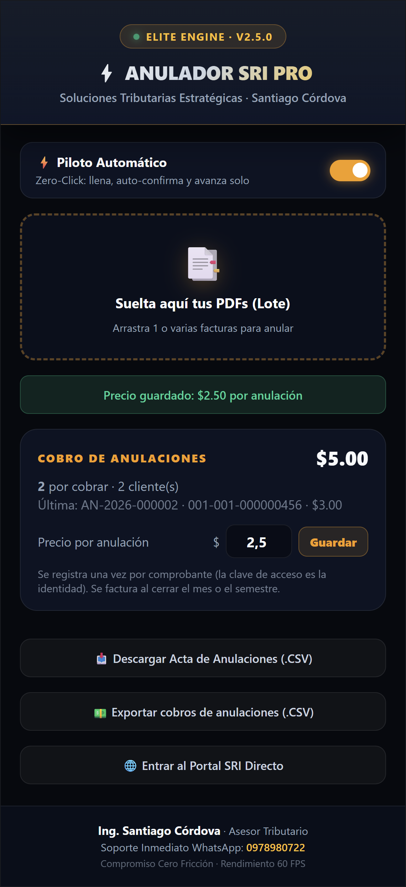

# Estado actual — extensiones SC PRO (nov-2026)

Qué se hizo, qué se verificó y qué sigue abierto. Reemplaza como foto de hoy a
los informes de septiembre (que se conservan como diagnóstico histórico en
`INFORME_COHERENCIA_EXTENSIONES.md`).

---

## 1. Lo que cambió

### 1.1 Nació la suite

`suite/` es una quinta extensión que contiene los cuatro módulos. No es un
fork: es un artefacto generado desde `01`, `02`, `03` y `04` con
`tools/construir_suite.mjs`.

- **Popup**: es el panel de la 01 tal cual (lote de clientes, período,
  herramientas, ajustes), con un botón 🧰 que abre el riel de la suite.
- **Riel**: lista los cuatro módulos con el estado real en la pestaña que se
  está mirando (*en esta pestaña / en el portal / en otra pestaña*) y lleva al
  portal de cada uno.
- **Aislamiento**: cada módulo va envuelto en una IIFE. Los cuatro comparten el
  mismo mundo aislado de la extensión; sin eso, dos `const` homónimos en
  archivos distintos serían un `SyntaxError` que mata el módulo sin avisar.
- **Assets**: `vendor/` (catastro, CIIU, jsPDF) y `libs/` (pdf.js) se copian a
  las rutas fijas que los módulos piden con `chrome.runtime.getURL`.

Se dejaron afuera los `.map` de pdf.js y `node_modules`: ~98 MB de peso que no
hacen falta para instalar la suite.

### 1.2 Orden en la carpeta

| Antes | Ahora |
| :--- | :--- |
| 4 `.md` + 1 `.pdf` sueltos en la raíz | `docs/` |
| `_ARCHIVADAS_Y_LEGACY/` | `_archivo/legacy/` |
| `_RESPALDO_EXTENSIONES_SEGURA/` | `_respaldos/extensiones_2026/` |
| `_respaldo_04_anulador/` | `_respaldos/04_anulador_previo/` |
| `New Folder/` (vacía) | eliminada |
| `03_.../desktop.ini` (apuntaba a un instalador ajeno) | `_archivo/cruft/` |
| — | `suite/`, `tools/`, `README.md` |

**Las rutas de las cuatro extensiones no cambiaron**: Chrome no pierde las que
ya estén cargadas. `_EVIDENCIA_SRI/` tampoco se movió, a propósito: sus reglas
de `.gitignore` dependen de la ruta.

### 1.3 Nombres de manifiesto

Los cuatro módulos quedaron con el mismo formato `[SC PRO NN]`, y la suite con
`[SC PRO SUITE]`. Antes la 01 se llamaba “SC TaxPilot PRO” y la 04 “SC SUITE
COMERCIAL v3.0”, que no decían a qué número de módulo correspondían.

### 1.4 Capa de experiencia: dos modos, cronómetro y resumen

`01_Nueva_Luz_3.0/src/08_experiencia.js` (módulo nuevo, 01 pasa a **3.2.0**,
suite a **4.1.0**). No modifica el motor del bucle ni los paneles: se engancha
desde afuera y, si falla, sólo se cae esta capa.

- **Modo limpio / cockpit** con el ojo 👁 del HUD o `Alt+Shift+M`, recordado en
  `sc_modo_vista`. En limpio quedan ▶ · estado · cliente · ⏱ · 📋 · 👁 · 🏁 · 🛑
  y desaparecen panel, isla del login, saludo y cajón.
- **Cronómetro del lote** en el HUD: tiempo en curso, por cliente y estimación
  de lo que falta; descuenta pausas y sobrevive a una recarga.
- **Resumen al terminar**, con tiempo total, por cliente, promedio y motivo;
  se reabre desde 📋. Se guardan las últimas 10 corridas.
- **Nombre del cliente en curso** en el HUD (antes había que abrir el panel).
- **Estado dormido 💤** cuando el perfil no declara IVA o ya está declarada.
- **Lanzador de clientes 🧑** para entrar a uno solo sin pasar por el popup.

Todo es local (`chrome.storage.local`): no agregó R2, Supabase ni ninguna API
paga. Detalle completo en
[`01_Nueva_Luz_3.0/EXPERIENCIA_2026-11.md`](../01_Nueva_Luz_3.0/EXPERIENCIA_2026-11.md).

### 1.5 Puerta de calidad y runbook (lo interno)

- **`tools/verificar.ps1`**: un comando que valida la sintaxis de los 22
  archivos que se empaquetan, compila la 01, corre los 909 bancos, regenera la
  suite y comprueba que sea determinista, y valida los cinco manifiestos.
  `-ConNavegador` suma las tres pruebas de Edge; `-SaltarBanco` deja una
  pasada rápida de 14 s para iterar.
- **`.github/workflows/extensiones.yml`**: lo mismo en cada push/PR que toque
  `extenciones web/`, sobre Linux con el Chrome del runner.
- **`docs/RUNBOOK.md`**: ciclo de cambio, versionado, checklist de entrega,
  rollback, incidentes frecuentes, rotación de secretos y onboarding.

La idea es que “¿esto está entregable?” tenga una respuesta de un comando y no
de una revisión a ojo.

### 1.6 La evidencia real, al lado del código

El recorrido de Burp vivía sólo en `_EVIDENCIA_SRI/`, lejos de la extensión
que se estaba puliendo. Desde el 07-nov-2026 cada módulo tiene su
`recorridos/` con una **copia de trabajo** (byte a byte, verificada por
hash):

| Extensión | Qué tiene |
| :--- | :--- |
| 01 | 12 trazas · 8 documentos · 13 capturas · 4 PDFs · 3 diccionarios (112 MB) |
| 02 | la traza del cambio de clave |
| 03 y 04 | vacías: **falta capturar** el anexo y la anulación |

Cada carpeta trae un `LEEME.md` con qué abrir primero y qué buscar; el mapa
completo está en [`RECORRIDOS.md`](RECORRIDOS.md). Las copias están en
`.gitignore`. Chrome las carga con la extensión (no se pueden llamar con `_`,
porque Chrome rechaza la extensión entera), así que al armar un ZIP hay que excluirlas. La fuente sigue siendo `_EVIDENCIA_SRI/`.

---

## 2. Lo que se verificó (y lo que no)

### Verificado con pruebas reales

- **El manifiesto de la suite carga** y el service worker arranca
  (`tools/prueba_suite.ps1`, en Edge 157 porque Chrome estable ignora
  `--load-extension`).
- **El popup abre** con el panel de clientes de la 01 y **el riel monta sus 4
  filas** (`botonRiel: true`, `4 filas / modulos=01,02,03,04`).
- **Un módulo empaquetado se inyecta y ejecuta**: el 02 como canario completa
  `clave123*` → `clave123@` en una página local (`tools/prueba_inyeccion.ps1`),
  y el clic en Guardar entra en la rama que usa el puente de Supabase, o sea
  que la concatenación de `supabase_bridge.js` + `content.js` dentro de la
  misma IIFE funciona.
- **La capa de experiencia**, sobre una página servida con el host del SRI
  (`srienlinea.sri.gob.ec` → 127.0.0.1): el HUD monta su bloque nuevo, el ojo
  cambia a `limpio` (con `#slh-paso` en `display:none`) y vuelve a `cockpit`,
  y una corrida simulada de 3 clientes muestra nombre, cronómetro, estimación
  y abre el resumen con el tiempo por cliente al detenerse.
- **Sin excepciones** en consola del popup ni de la página de prueba.

### No verificado

- **La suite contra el portal real del SRI.** Las pruebas de arriba usan una
  instancia limpia, una página local y un host mapeado a 127.0.0.1; no prueban
  login real, formularios ni selectores. Antes de declarar en serio:
  `suite/README.md` § *Primera prueba*.
- **La 03 y la 04 empaquetadas en su página real** (anexo de gastos y
  `menuAnulacion.jsf`). Su código es el mismo de las individuales, pero nadie
  las corrió todavía desde la suite.
- **El lanzador de clientes 🧑** (arrancar un cliente suelto desde el HUD): el
  contrato de almacén está copiado del popup y revisado, pero no se ejecutó una
  corrida real desde ahí.
- **El chip 💤**: depende del veredicto del perfil, que sólo se puede ejercitar
  con un contribuyente real sin obligación de IVA.

---

## 3. Lo que sigue abierto

### 🔴 P0 · Rotar la clave de Gemini y el token de GitHub

**Código: resuelto (07-nov-2026).** La constante con la clave salió de
`03_Anexo_Gastos_Personales/content.js`; ahora se lee de
`chrome.storage.local` (`sc_ia_credenciales.apiKey`, la misma entrada que usa
la 01), y se carga desde el popup de la 03 (**IA · Gemini**) o desde Ajustes
de la 01/suite. Si no hay clave, la IA se apaga y la clasificación sigue por
catastro + mapeos; no se rompe nada. `git grep AIzaSy` en el árbol de trabajo:
**0 archivos**.

**Credenciales: pendiente de rotar.** La clave vieja sigue en el historial de
git y en `_respaldos/` (borrarla del archivo no la des-compromete). Lo mismo
con el token de GitHub que estaba embebido en la URL de `origin`
(`.git/config`, no versionado). Rotar las dos y, para el token, pasar a
credential manager o SSH — receta en [`RUNBOOK.md`](RUNBOOK.md) §6.

### 🟢 P1 · La 04 quedó restaurada al motor que funciona

El 07-nov-2026 se invirtió la decisión: **el 04 oficial volvió al motor
`v2.5`** (`[SC MOTOR PRO] Anulador SRI — Llenador & Envío Bucle`), que es el
que el usuario usa y funciona. El rediseño `v3.0` (“SC SUITE COMERCIAL”, el que
se trababa) quedó archivado en `_archivo/04_anulador_v3_experimental/`, con sus
tests y su listing, por si se retoma.

Por qué: el 04 canónico tenía el rediseño que no completa, y el que andaba
vivía en una carpeta de respaldo (que además se movió y Chrome marcó como
“movido”). Ahora hay **un solo 04**, en la ruta correcta, con el código que
funciona. La traza de Burp de `menuAnulacion.jsf` deja de ser un bloqueo y pasa
a ser blindaje (ver `RECORRIDOS.md`).

### 🟡 P2 · Las claves no se comparten entre suite e individuales

`chrome.storage.local` es por extensión. La suite arranca sin las claves SRI,
sin la clave de IA, sin los mapeos de la 03 y sin las credenciales de R2 de las
individuales. Migración manual, una sola vez, desde la consola del service
worker de cada extensión (`chrome://extensions` → *service worker*):

1. En la extensión vieja:
   `chrome.storage.local.get(null, d => console.log(JSON.stringify(d)))`
2. Copiar el JSON y, en el service worker de la suite:
   `chrome.storage.local.set(JSON.parse(`…`))` (sustituir por el JSON).

Hacerlo con el navegador sin datos sensibles a la vista: el JSON incluye
contraseñas SRI.

### 🟡 P2 · Deuda de UI de la 01 (en parte, mitigada)

Los controles duplicados (dos pausas, dos stops, tres sync), las ~396 etiquetas
`style` inline y la barra de clientes que se pisa con el cockpit del login
siguen como estaban: es la deuda que describe `INFORME_COHERENCIA` §3. Se
arregla **con el portal delante**, no a ciegas.

Lo que sí cambió con la capa de experiencia: la **saturación percibida** baja
mucho con el modo limpio (un clic) sin tocar ninguno de esos controles. La
deuda de fondo —un control por acción— sigue abierta.

### 🟡 P2 · 01: regenerar el bundle antes de la suite

La suite se lleva `01_Nueva_Luz_3.0/build/content.js`. Si se edita `src/` y no
se corre `npm run build` en la 01, la suite viaja con el bundle viejo. El
constructor lo detecta por fechas y avisa, pero no lo arregla solo.

---

## 4. Decisiones de diseño (y por qué)

- **Sin interruptores por módulo.** Se podría registrar cada módulo con
  `chrome.scripting.registerContentScripts` y apagarlos desde el popup. No se
  hizo: los content scripts estáticos son exactamente el mismo mecanismo que ya
  funciona en las individuales, y un fallo de registro dinámico dejaría un
  módulo muerto sin señal visible. La convivencia se resuelve con la regla “un
  módulo, una extensión”.
- **No se reutilizan los popups de 02/03/04.** Esos popups consultan la pestaña
  activa del navegador; dentro de otro popup el destinatario sería el propio
  popup (navegarían la ventana equivocada). Los cuatro módulos ya montan su
  interfaz dentro de la página del SRI.
- **No se renombraron las carpetas 01–04.** Moverlas habría cambiado la ruta de
  instalación de las extensiones que ya están cargadas en Chrome. La numeración
  ya da el orden; el orden que faltaba era de las carpetas de respaldo.
- **`_EVIDENCIA_SRI` no se movió.** Su protección depende de rutas exactas en
  `.gitignore`; renombrarla habría dejado ~113 MB de datos de contribuyentes a
  un `git add` de distancia.

---

## 5. Qué haría después, en orden

| # | Acción | Por qué |
| :-: | :--- | :--- |
| 1 | **Rotar** la clave de Gemini y el token de GitHub, y sacar el token de la URL de `origin` | El código ya está limpio; las credenciales viejas siguen vivas en el historial y en el disco |
| 2 | Primera prueba de la suite en el portal, con un cliente de prueba | Es el único paso que falta para poder usarla |
| 3 | Probar el cronómetro y el resumen en una corrida real de 7 clientes | Valida lo agregado y deja el tiempo base de referencia |
| 4 | Probar el 04 restaurado (motor v2.5) con un comprobante de prueba | Confirma en el portal lo que ya funciona en la carpeta; la traza de anulación queda como blindaje |
| 5 | Migrar claves a la suite y desinstalar las individuales que ya cubre | Evita duplicar paneles y claves desincronizadas |
| 6 | Visual de recolección y llenado (fase 2 de la capa de experiencia) | El progreso por comprobante y por casillero es lo que falta para “ver siempre” |
| 7 | Consolidar la UI de la 01 (controles duplicados) | La deuda que genera bugs de control, con el portal delante |
### 1.7 Cobro de anulaciones ($2 por comprobante)

El 04 ahora **numera y registra cada anulación** para poder cobrarla al cerrar
el mes o el semestre:

- Consecutivo propio (`AN-2026-000123`), lote del día (`L-20261107`) y período
  (`2026-11`).
- **Idempotente por clave de acceso**: reintentar el mismo comprobante no
  cobra dos veces; si el SRI lo rechaza queda `no_cobrable` (precio 0) y, si
  después se anula bien, pasa a `pendiente` una sola vez.
- Precio configurable (global $2, y el storage ya soporta precio por cliente).
- Tarjeta en el popup: total por cobrar, clientes, última anulación y precio
  editable; exportación de cobros en CSV además del acta.
- En la web: `types/annulment.ts` + `services/annulmentBilling.ts` (funciones
  puras de pendientes, resumen, línea de factura y marcado de facturado). El
  `tsc --noEmit` del proyecto da **0 errores**.

Falta la pestaña en la Bóveda del cliente y el botón de Cobranza para volcar
el período a la factura. Diseño completo y casos borde en
[`ANULACIONES_COBRO.md`](ANULACIONES_COBRO.md).

